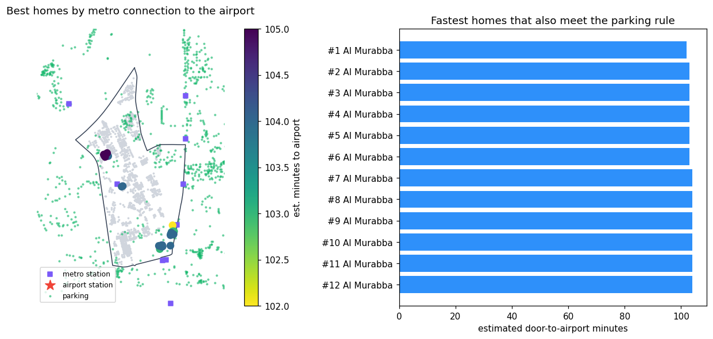

# Geo-RiyadhAI

A map-first urban-intelligence app for Riyadh, built on [GeoAcquirer](../geoacquirer/README.md). Pick any district or neighbourhood, ask a question in plain words, and get a short answer, the places on the map, a chart or table, and a statement of how sure the system is and what it cannot know.



## What it does

* **Whole-city map divided by district.** 867 districts and neighbourhoods from three independent sources (Urbi/2GIS, Suhail, Overture), with every building, land parcel, parking lot, street, landmark and metro object assigned to them (nothing dropped) and drawn as polygons, or as centroids where a source gives no outline. Vector tiles keep it fast.
* **Plain-language answers.** A headline, key numbers, how sure the system is, what it cannot tell you, and follow-up questions. Technical detail (every calculation id) sits behind a switch.
* **Built-in analyses:** constraint search with evidence (VERIFIED / PROBABLE / INSUFFICIENT / REJECTED), counts per district, site suitability with sensitivity analysis, p-median and max-coverage facility placement (greedy, local search and CP-SAT against baselines), simulated what-if scenarios, a spatially cross-validated LightGBM land-use model, and cited reference notes.
* **A code-writing analysis agent.** For questions the built-in tools do not cover, a language model plans the analysis, writes pandas/geopandas code, the code runs in an isolated process, and the result is plotted and explained, with every number in the answer audited against what the code produced. Supporting parts: geo-RAG (data notes, English/Arabic place lookup, verified past analyses), budgeted model sub-calls from inside the code, and approval-gated acquisition of missing open data. See [`docs/agentic_analysis.md`](docs/agentic_analysis.md).

## Run it

```bash
pip install -e ../geoacquirer -e ".[dev]"
pytest                                    # offline; synthetic area with planted ground truth
python -m riyadhai.cli serve --data data_city --port 8080     # then open http://127.0.0.1:8080
```

Use `127.0.0.1`, not `localhost` (on Windows `localhost` can add a 2-second delay to every request).

The app needs prepared map data that this repository does **not** contain. Build it by following [`docs/data_preparation.md`](docs/data_preparation.md) (downloads, then `scripts/`). Without it, the tests and the synthetic demos still run.

### Optional: language model for the analysis agent

Copy `.env.example` to `.env` and set **one** option (restart the server afterwards; real environment variables override the file):

```
ANTHROPIC_API_KEY=...                       # option A (optional ANTHROPIC_BASE_URL, RIYADHAI_LLM_MODEL)
RIYADHAI_LLM_URL=https://api.example/v1     # option B: any OpenAI-compatible endpoint (OpenAI, Groq, Ollama, vLLM...)
RIYADHAI_LLM_MODEL=model-name
RIYADHAI_LLM_KEY=...
```

Check `GET /v1/health`: `"llm": true`. Without a model only the built-in tools and the vetted recipes run; other custom questions are declined, never guessed.

## Layout

```
src/riyadhai/     app, tools, planner, executor, store, optimisation, ML, the code agent, geo-RAG, sandbox, API
frontend/         the map workspace (MapLibre; vanilla JS)
scripts/          data preparation (see docs/data_preparation.md), tile generation, verification
benchmarks/       reproducible evaluations (results/ holds the last run)
tests/            offline test-suite
docs/             architecture, tools, data, evaluation, limitations
```

## Measured results (details and caveats in `docs/`)

* 83 automated tests pass (offline). The full evaluation harness (`benchmarks/full_evaluation.py`) handles 248/248 edge cases and 28/28 API checks across four prepared areas.
* Spatial correctness is checked against brute force (0 mismatches). The planner understood 26/26 in-grammar gold questions but only 8/14 fresh paraphrases, which is why the code agent exists.
* Land-use model: PR-AUC 0.80 vs 0.10 for the majority baseline, on noisy OSM-derived labels with 1 km block spatial cross-validation.
* A landmark query run through the agent (residential buildings within 500 m of Kingdom Centre) matched an independent calculation exactly. This is a small smoke test, not a benchmark of the agent.

## Limits you should know

No population, traffic, land-price, sales or parking-occupancy data: rankings are estimates from what is built and mapped. Zoning is Suhail's attribute mapped by keyword, not a legal determination. Parcel coverage has a gap at the outer edge of the city. The agent's code quality with different language models has not been measured. Read [`docs/limitations.md`](docs/limitations.md) before using any result.

## Data and licences

Code is MIT. No data is included. Overture and OpenStreetMap data are open (attribution required); Urbi/2GIS and Suhail data require your own access and permission and are disabled in the code until you record an authorization. See [`../NOTICE.md`](../NOTICE.md).
